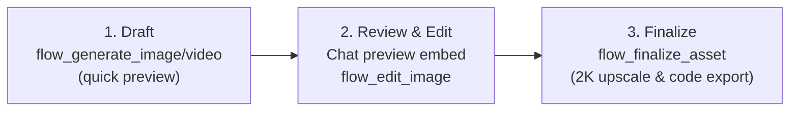

# Google Flow MCP Server

[](LICENSE)
[](https://www.python.org/downloads/)
[](https://playwright.dev/)

An MCP (Model Context Protocol) server that empowers AI agents (Antigravity, Claude Desktop, Cursor) to generate production-quality visual media using **Google Flow** (powered by Imagen and Veo models) completely in the background, with **zero per-token API costs** by leveraging your Google AI Pro subscription.

---

## 🌟 Key Features

* **Zero API Cost**: Uses your active Google AI Pro / Google Flow subscription quotas instead of metered cloud API calls.
* **100% Invisible Background Execution**: Runs via headless browser automation or attaches seamlessly to Chrome via CDP (port 9222). No focus stealing.
* **V3 Studio Staging Pipeline**: 3-step interactive draft review and finalization workflow (`flow_finalize_asset`) with automatic 2K upscaling.
* **Veo & Imagen Models**: High-resolution image generation and cinematic video generation.
* **Aspect Ratio Selection**: Support for `16:9`, `9:16`, `1:1`, and `4:3`.
* **Cinematic Camera Director**: Controls camera motion (`pan_left`, `pan_right`, `tilt_up`, `tilt_down`, `zoom_in`, `zoom_out`, `orbit`, `static`).
* **Prompt Expander**: Automatic enrichment of prompts with professional lighting, optics, and atmospheric descriptors.
* **Frames-to-Video Animation**: Interpolate between starting (`start_frame`) and final (`end_frame`) images.
* **Video Extension**: Extend generated videos by another 5–8 seconds.
* **2K Upscaling**: Request 2K versions directly or upscale previously generated images.
* **Image-to-Image / Reference Input**: Attach local reference images to guide generation or seed video clips.
* **Direct Asset Delivery**: Automatically downloads rendered media files directly into your project's assets folder and provides Markdown embed links.

---

## 🎬 3-Step Studio Staging Workflow



---

## 🚀 Quick Start

### 1. Installation

```bash
git clone https://github.com/your-username/google-flow-mcp.git
cd google-flow-mcp
uv venv
uv pip install -r requirements.txt
playwright install chromium
```

### 2. First-Time Authentication

Run the interactive login script once to save your session cookies:

```bash
uv run python auth.py
```

A browser window will open. Sign in to your Google Account with Google AI Pro access, navigate to [flow.google.com](https://flow.google.com), and the session state will automatically be saved to `storage_state.json`.

---

## 🛠 Available Tools

| Tool | Parameters | Description |
|---|---|---|
| **`flow_generate_image`** | `prompt` (string, required)<br>`reference_image` (string, optional)<br>`aspect_ratio` (string, optional: `16:9`, `9:16`, `1:1`, `4:3`)<br>`expand_prompt` (bool, default: False)<br>`upscale_2k` (bool, default: False)<br>`output_dir` (string, optional)<br>`timeout_seconds` (int, default: 90) | Generates images via Imagen 3/4. Supports reference input, aspect ratio, prompt expansion, and 2K upscaling. |
| **`flow_generate_video`** | `prompt` (string, required)<br>`reference_image` (string, optional)<br>`aspect_ratio` (string, optional)<br>`camera_motion` (string, optional: `pan_left`, `orbit`, etc.)<br>`expand_prompt` (bool, default: False)<br>`output_dir` (string, optional)<br>`timeout_seconds` (int, default: 150) | Generates cinematic video clips via Veo with camera controls. |
| **`flow_frames_to_video`** | `start_frame` (string, required)<br>`end_frame` (string, required)<br>`prompt` (string, optional)<br>`aspect_ratio` (string, optional)<br>`output_dir` (string, optional)<br>`timeout_seconds` (int, default: 180) | Generates a video interpolating between starting and ending frames. |
| **`flow_extend_video`** | `tile_index` (int, default: -1)<br>`prompt` (string, optional)<br>`output_dir` (string, optional)<br>`timeout_seconds` (int, default: 180) | Extends an existing video tile by an additional 5–8 seconds. |
| **`flow_finalize_asset`** | `target_path` (string, required)<br>`source_file` (string, optional)<br>`tile_index` (int, default: -1)<br>`upscale_2k` (bool, default: True)<br>`timeout_seconds` (int, default: 90) | Atomically upscales the chosen asset to 2K and saves it directly into the user's project folder. |
| **`flow_upscale_image`** | `tile_index` (int, default: -1)<br>`output_dir` (string, optional)<br>`timeout_seconds` (int, default: 90) | Upscales a previously generated image in the project to 2K resolution. |
| **`flow_edit_image`** | `prompt` (string, required)<br>`tile_index` (int, default: -1)<br>`reference_image` (string, optional)<br>`aspect_ratio` (string, optional)<br>`upscale_2k` (bool, default: False)<br>`output_dir` (string, optional)<br>`timeout_seconds` (int, default: 90) | Applies modifications or creates variations of an existing image. |
| **`flow_check_status`** | *none* | Checks whether the session is authenticated and ready to generate. |

---

## 📄 License

MIT License. Feel free to use, modify, and distribute.
